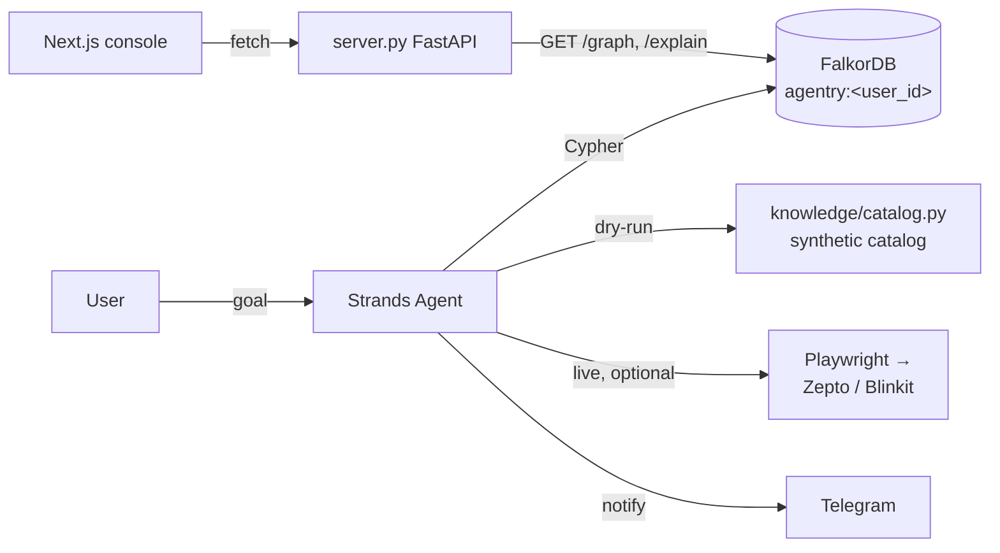

# Agentry

**An autonomous grocery agent that plans, shops, and checks out — end to end, without a human clicking through the flow.**

---

## Graph Hacks submission (WeMakeDevs × FalkorDB)

**Tracks entered:** Track 02 — *Agent Memory and Coordination* (primary), with a Track 01 — *Agents That Act on Connected Data* angle (the PageRank anchor-item query).

**Why the graph is central, not decorative:** every restock suggestion, co-purchase round-out, substitution, and episodic "what did we decide last time" lookup runs as a Cypher query against FalkorDB. There is no local-file or in-memory fallback — `knowledge/graph.py` talks to FalkorDB directly, and if it's unreachable, every one of those tool calls fails loudly instead of degrading quietly. Remove FalkorDB and the agent has no purchase memory at all: `get_restock_suggestions`, `explain_suggestion`, `recall_decisions`, and `rank_anchor_items` all stop working.

### Data model

| Node | Properties |
|---|---|
| `User` | `id` |
| `Product` | `sku`, `name`, `category`, `purchase_count`, `interval_sum_days`, `avg_interval_days`, `last_purchased_ts` |
| `Order` | `id`, `ts` |
| `Category` | `name` |
| `Session` | `id`, `ts`, `goal` — episodic memory anchor |

| Relationship | Properties | Meaning |
|---|---|---|
| `(User)-[:PURCHASED]->(Product)` | `ts`, `qty`, `order_id`, `platform` | direct purchase edge |
| `(User)-[:PLACED]->(Order)` | — | which user placed an order |
| `(Order)-[:CONTAINS]->(Product)` | `qty` | order line items |
| `(Product)-[:CO_PURCHASED_WITH]->(Product)` | `count`, `last_ts` | stored once per unordered pair (sku-sorted), read with an undirected pattern |
| `(Product)-[:IN_CATEGORY]->(Category)` | — | for category-based round-outs |
| `(Product)-[:SUBSTITUTE_FOR]->(Product)` | `reason` | known substitute pairs |
| `(Session)-[:DECIDED]->(Product)` | `action`, `reason` | episodic memory: `purchased`, `accepted_substitute`, `rejected_substitute`, `out_of_stock` |

### Cypher the product depends on (all in `knowledge/graph.py`)

- **`restock_suggestions`** — `due_for_restock`: products where `now - last_purchased_ts >= avg_interval_days` (within a tolerance window), each paired with its top `CO_PURCHASED_WITH` neighbors.
- **`co_purchase_suggestions`** — multi-hop: 1-hop `CO_PURCHASED_WITH` from every seed item (e.g. the current cart), plus a weaker 2-hop signal via shared `Category`, excluding anything already in the seed set.
- **`substitute_candidates`** — `SUBSTITUTE_FOR` edges, re-ranked by prior `DECIDED` edges (`accepted_substitute`/`rejected_substitute`) so a past rejection doesn't get re-suggested.
- **`explain_path`** — the actual graph paths behind a suggestion (restock stats, co-purchase neighbors, substitutes, decision history) as a structured hop list, plus the exact Cypher used — this is what `tools/explain_suggestion.py` hands the agent.
- **`rank_anchor_items`** — `CALL algo.pageRank('Product', 'CO_PURCHASED_WITH') YIELD node, score` — FalkorDB's own graph algorithm, surfacing which items are structurally central to a household's shopping pattern rather than just most-frequently-bought.

### Architecture



### Local setup (this submission)

```bash
# 1. FalkorDB
docker run -d --name falkordb -p 6379:6379 falkordb/falkordb

# 2. Python deps (no NetworkX anywhere — falkordb is the only graph dependency)
pip install -r requirements.txt

# 3. Seed ~60 days of synthetic purchase history for two demo households
python scripts/seed_graph.py

# 4. Run the agent end to end with no Playwright/storefront login needed
export AGENTRY_DRY_RUN=1          # Windows: set AGENTRY_DRY_RUN=1
python main.py --goal "restock the pantry"

# 5. Optional — web console (chat + FalkorDB-backed graph view), two terminals:
uvicorn server:app --reload --port 8000
cd web && pnpm install && pnpm dev   # http://localhost:3000/console
```

Switch households by setting `AGENTRY_USER_ID=demo2` (seeded alongside `demo`) before running the agent or server.

### Disclosure

1. **Agentry predates this hackathon.** It was originally built for the [Agents for Humans Hackathon](https://agentsforhumans.devpost.com/) (AWS × Strands Agents SDK), adapted from a pre-existing project (Zepto402 → Pantry → Agentry). The agent orchestration (Strands), storefront automation (Playwright), and Telegram notification layer are that prior work — see the section below for the original submission's own disclosure.
2. **Everything FalkorDB-related is new, built Oct 15-18, 2026 for Graph Hacks:** the graph data model and every Cypher query/algorithm call in `knowledge/graph.py`, `scripts/seed_graph.py`, the `explain_suggestion`/`recall_decisions`/`rank_anchor_items` tools, the `AGENTRY_DRY_RUN` mock-storefront path (`tools/_dry_run.py`, `knowledge/catalog.py`), and the `/api/graph` + `/api/explain` FastAPI endpoints and console wiring. NetworkX has been removed entirely — there is no fallback path if FalkorDB is down.
3. **AI coding assistance:** Claude Code was used throughout this build; all code was reviewed and the author can explain any part of it.
4. **Data:** every purchase, order, substitution, and decision in the demo graph is synthetic, generated by `scripts/seed_graph.py` with a fixed random seed. No real Zepto/Blinkit order history, wallet data, or logged-in session content is ever loaded into FalkorDB.

---

## Original submission: Agents for Humans Hackathon (AWS × Strands Agents SDK)

Built for the [Agents for Humans Hackathon](https://agentsforhumans.devpost.com/) (AWS × Strands Agents SDK) — **Everyday Agents** track. Everything below this line describes that original submission; the Graph Hacks work above is layered on top of it, not a replacement for it.

---

## The problem

Grocery ordering is a small, repetitive chore that still demands full attention: browsing a storefront, checking what's actually in stock, picking substitutes, and clicking through checkout — every time the pantry runs low. It's minor on any one day, but it adds up to real time and attention lost to a task that doesn't need a human doing the clicking.

## What Agentry does

Agentry takes a goal — *"restock the pantry"* or a specific shopping list — and handles it autonomously:

1. **Plans** the order from the goal (what's needed, in what quantity)
2. **Shops** by driving a real quick-commerce storefront directly (search, cart, substitutions)
3. **Pays** using the storefront's own wallet balance at checkout (e.g. Zepto Cash)
4. **Only interrupts you** when there's a real decision to make — an item is out of stock, a price has jumped, a substitution needs your call — via Telegram

It's not a chatbot you have to manage. It runs in the background and reports back.

## Who it's for

Anyone who wants grocery restocking off their plate — busy professionals, people running a household, anyone who'd rather approve a decision than execute a checklist.

---

## How it works

Agentry is built as a [Strands Agents SDK](https://strandsagents.com/) agent. The model reasons over the shopping goal and drives a small set of tools that do the actual work; the agent loop, tool orchestration, and decision-making all run without step-by-step human input.

```
User goal ("restock the pantry")
        |
        v
   Strands Agent  <----->  Model provider (Gemini, via Strands' GeminiModel)
        |
        |-- @tool: get_restock_suggestions --> what's likely due (Cypher, FalkorDB)
        |-- @tool: rank_anchor_items       --> PageRank over the co-purchase graph (FalkorDB)
        |-- @tool: explain_suggestion      --> the graph path behind a suggestion (FalkorDB)
        |-- @tool: recall_decisions        --> past session decisions for an item (FalkorDB)
        |-- @tool: search_products         --> look up items without committing to a purchase
        |-- @tool: add_to_cart             --> add a found item to the cart
        |-- @tool: view_cart               --> read back cart contents + total
        |-- @tool: check_wallet_balance    --> read platform wallet balance (e.g. Zepto Cash)
        |-- @tool: checkout                --> pay + place the order (confirm=True required)
        |-- @tool: record_purchase         --> log a completed order for next time
        |-- @tool: notify_user             --> Telegram (confirmations / decisions needed)
        |
        v
   Completed order + a message in your pocket
        |
        v
   (optional, stretch) Deployed to Bedrock AgentCore Runtime for a live demo link
```

### Tech stack

| Layer | Tool |
|---|---|
| Agent framework | [Strands Agents SDK](https://strandsagents.com/) |
| Model | Google Gemini (via Strands' `GeminiModel` provider), default — or AWS Bedrock (open-weight models via its OpenAI-compatible Mantle endpoint, `OpenAIModel`) via `MODEL_PROVIDER=bedrock-mantle` |
| Storefront automation | Playwright (stealth browser automation); `AGENTRY_DRY_RUN=1` swaps in a synthetic mock catalog, no Playwright/login needed |
| Payments | Platform-native wallet balance at checkout (e.g. Zepto Cash) |
| Purchase memory | **FalkorDB** — restock timing, co-purchase, substitutes, and episodic "what did we decide last time" memory, all Cypher (see "Graph Hacks submission" above) |
| Notifications | Telegram Bot API |
| (Stretch) Deployment | Amazon Bedrock AgentCore Runtime |

---

## Getting started

### 0. Hackathon account setup (do this early — separate deadlines apply)

1. [Create a free AWS account](https://signin.aws.amazon.com/signup?request_type=register) if you don't have one
2. Create an **AWS Builder ID** (separate from an AWS account) — required as a submission field
3. Request **$50 in AWS Promotional Credits** via the form linked on the [hackathon Resources page](https://agentsforhumans.devpost.com/resources) — **due September 11, 2026, 12pm PT**, before the Sep 14 submission deadline
4. [Install the Strands Agents SDK](https://strandsagents.com/docs/user-guide/quickstart/overview/) — the quickstart gets a working agent running in under 20 minutes

### Prerequisites

- Python 3.10+
- Docker (for FalkorDB), or a reachable FalkorDB instance
- A Gemini API key
- A Telegram bot token (for notifications)
- A storefront account with a funded platform wallet (e.g. Zepto Cash) to pay from — not needed if you're running with `AGENTRY_DRY_RUN=1`

### Installation

```bash
git clone https://github.com/anbusan19/agentry.git
cd agentry

python -m venv .venv
source .venv/bin/activate      # Windows: .venv\Scripts\activate

pip install 'strands-agents[gemini]' strands-agents-tools
pip install -r requirements.txt

playwright install --with-deps chromium

# FalkorDB — the purchase-memory graph
docker run -d --name falkordb -p 6379:6379 falkordb/falkordb
python scripts/seed_graph.py   # synthetic demo history for users "demo"/"demo2"
```

### Configuration

Create a `.env` file in the project root (never commit this — see `.gitignore`):

```bash
# Gemini is the default model provider
GEMINI_API_KEY=your_gemini_api_key
TELEGRAM_BOT_TOKEN=your_telegram_bot_token
TELEGRAM_CHAT_ID=your_chat_id
```

To use AWS Bedrock instead, set `MODEL_PROVIDER=bedrock-mantle` plus `AWS_ACCESS_KEY_ID`, `AWS_SECRET_ACCESS_KEY`, `AWS_REGION`, and `MANTLE_MODEL_ID` — see `.env.example` for the full set. This routes through Bedrock's OpenAI-compatible Mantle endpoint via Strands' `OpenAIModel`, which mints its own short-lived bearer token per request, so real IAM credentials are required (not just an `AWS_BEARER_TOKEN_BEDROCK` login).

### Log in to the storefront (once)

The storefront tools reuse a saved browser profile rather than automating phone/OTP login. Run this once and log in manually in the window that opens:

```bash
python scripts/capture_session.py
```

It opens a real (visible) browser window and waits. Once you're logged in, signal it from another terminal:

```bash
touch /tmp/agentry_capture_done
```

The session is saved to `tools/.sessions/` (gitignored) and every tool call reuses it from then on.

### Running locally

```bash
python main.py --goal "restock the pantry"
```

Agentry will plan the order, search and add items to the cart, pay from the platform wallet balance (e.g. Zepto Cash), and send a Telegram message when it's done — or sooner, if it needs a decision from you.

To run the full loop with no Playwright/storefront login at all (the Graph Hacks demo path), set `AGENTRY_DRY_RUN=1` first — `search_products`/`add_to_cart`/`view_cart`/`checkout` all run against the synthetic catalog in `knowledge/catalog.py` instead, and `checkout` returns a simulated paid order with no real money moving.

### Web console (optional)

`web/` is a Next.js app with a chat window talking to a live Agent instance, and a force-directed view of the purchase-history knowledge graph next to it. It needs `server.py` running as a bridge:

```bash
# terminal 1 — the agent, exposed over HTTP
source .venv/bin/activate
uvicorn server:app --reload --port 8000

# terminal 2 — the frontend
cd web
pnpm install
pnpm dev
```

Then open `http://localhost:3000/console`. Conversation state and the browser session both live in the `uvicorn` process, so cart state carries across chat turns the same way it would across tool calls in a single `main.py` run.

---

## Project structure

```
agentry/
├── agent/
│   ├── agent.py               # Strands Agent definition + model config
│   └── prompts.py             # System prompt / planning instructions
├── tools/
│   ├── _session.py            # Shared Playwright session (not a tool itself)
│   ├── _dry_run.py             # Mock storefront for AGENTRY_DRY_RUN=1 (not a tool itself)
│   ├── get_restock_suggestions.py  # What's likely due (FalkorDB Cypher)
│   ├── rank_anchor_items.py    # PageRank over the co-purchase graph (FalkorDB algo)
│   ├── explain_suggestion.py   # Traceable reasoning behind a suggestion (FalkorDB)
│   ├── recall_decisions.py     # Episodic memory: past session decisions (FalkorDB)
│   ├── search_products.py     # Look up products without buying
│   ├── add_to_cart.py         # Add a found product to the cart
│   ├── remove_from_cart.py    # Undo a mistake, or clear an item
│   ├── view_cart.py           # Read back cart contents + total
│   ├── check_budget.py        # Weekly spend-cap check
│   ├── check_wallet_balance.py# Read platform wallet balance before paying
│   ├── checkout.py            # Pay + place the order (confirm=True required)
│   ├── record_purchase.py     # Log a completed order for next time
│   └── notify.py              # Telegram notification tool
├── knowledge/
│   ├── graph.py                # FalkorDB-backed purchase/co-purchase/substitute/episodic memory
│   ├── catalog.py               # Synthetic product catalog (seed script + dry-run mock)
│   └── budget.py                # Local spend log + budget-cap check
├── scripts/
│   ├── capture_session.py     # One-time interactive storefront login
│   └── seed_graph.py           # Synthetic demo purchase history -> FalkorDB
├── web/                        # Next.js landing page + chat/graph console
│   └── app/console/            # Chat window + knowledge-graph view
├── server.py                   # FastAPI bridge: web/ console <-> live Agent <-> FalkorDB
├── main.py                    # Entry point (CLI)
├── requirements.txt
├── .env.example
├── LICENSE
└── CLAUDE.md             # Guidance for Claude Code working in this repo
```

---

## Development workflow

Commit periodically and with meaningful messages rather than one giant commit at the end — this repo's git history is part of the evidence that the Strands port was genuinely built during the Aug 10 – Sep 14 submission window.

- Commit after each logical unit of work (a tool ported, a bug fixed, a working end-to-end run) rather than batching days of work into one commit
- Use a consistent prefix: `feat:`, `fix:`, `docs:`, `chore:`, `refactor:`
- Never commit `.env`, API keys, or wallet credentials — double check `.gitignore` covers them
- Push regularly so the remote history (with real timestamps) reflects the actual build timeline

Suggested cadence while building: commit at the end of each work session, and always right after you get something working end-to-end (a fresh checkpoint you can roll back to is worth more than a tidy history).

---

## Submission checklist

### Graph Hacks (WeMakeDevs × FalkorDB)

- [ ] Tracks: **Agent Memory and Coordination** (primary), **Agents That Act on Connected Data** (angle)
- [ ] FalkorDB is the primary datastore — confirmed no NetworkX/local-file fallback anywhere (`grep -r networkx` returns nothing)
- [ ] Public repo with source, setup instructions, this README
- [ ] Demo: `docker run falkordb`, `python scripts/seed_graph.py`, `AGENTRY_DRY_RUN=1 python main.py --goal "restock the pantry"`, console graph view
- [ ] Only synthetic/own data in the graph — no real storefront session data loaded

### Original: Agents for Humans Hackathon (AWS × Strands)

- [ ] Track: **Everyday Agents**
- [ ] Text description (features + functionality, who it's for, how it works)
- [ ] `LICENSE` file (MIT or Apache 2.0) — must show in the repo's **About** section
- [ ] Architecture diagram (image, not just this text block)
- [ ] Demo video, ≤5 min, uploaded **public to YouTube or Vimeo**, covering: (1) the problem, (2) who it's for, (3) why it matters, plus the agent working live
- [ ] AWS Builder ID linked in submission
- [ ] (Optional) Live demo link — scores better on Technical Implementation
- [ ] (Optional, bonus) builder.aws.com blog post with "Agents for Humans" in the title

## Demo video

[Link to demo video] *(add before submission — must be public on YouTube or Vimeo)*

## Live demo

[Link, if deployed] *(optional — strengthens Technical Implementation scoring)*

---

## License

Licensed under the [MIT License](LICENSE).

## Acknowledgments

Built on the [Strands Agents SDK](https://github.com/strands-agents/harness-sdk) for the Agents for Humans Hackathon, sponsored by AWS. Adapted from the Zepto402/Pantry project, renamed Agentry for this submission (see Disclosure above).